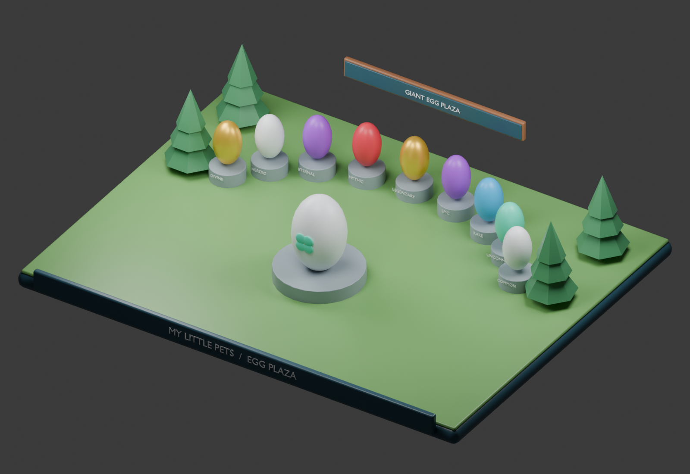

# MY LITTLE PETS

## System 4 — Egg Spinning & Pet Index System

## Specification status and dependencies

This is a development context document, not a claim of implemented Roblox gameplay. Rules inherited from the master concept remain the baseline. Any section labeled proposed or prototype is a concrete playtest recommendation and must be balanced before release. Unapproved monetization, Divine access, Huge acquisition, and future content remain explicitly gated.

All permanent changes are server-authoritative and saved in a versioned player profile. Failed profile loads must block spending and grants rather than overwrite real progress with defaults. Use bounded retries, session ownership, idempotent transaction IDs, and migration checks. Clients handle presentation and submit requests, never final rewards or balances.

## Purpose and collection rules

Coin egg spins supply biome pets. The Pet Index permanently records species discovery and unlocks cosmetic bat skins when a rarity collection is complete. Each biome has exactly 30 species: 5 Common, 5 Uncommon, 4 Rare, 4 Epic, 3 Legendary, 3 Mythic, 2 Eternal, 2 Heroic, and 2 Divine. Five planned biomes total 150 standard species. EXCLUSIVE uses a separate collection and never appears in ordinary coin spins or normal Egg Rush.

## Plaza and spin flow

Arrange giant themed egg pedestals in a semicircle with the selected egg prominent. Display the coin price, available species, individual probabilities, and inventory capacity before purchase. A pedestal is a product presentation, not a new rarity. The reference art's Secret label is decorative legacy concept text; production uses Eternal, Heroic, and Divine within the nine standard rarities.

On request, the server checks biome access, profile state, capacity, balance, and cooldown. It reserves inventory capacity, debits coins, rolls once using configured server weights, creates a uniquely identified pet, records discovery, and commits the result before sending the reveal. A request ID returns the same outcome on retry. Reveal animation must not determine rewards. Failed transactions leave the balance and inventory unchanged.

## Proposed Forest egg configuration

Use one Forest collection pool initially, with additional pedestal designs available for later distinct pools. Prototype price: 250K coins per spin. Proposed rarity probabilities: Common 45%, Uncommon 30%, Rare 15%, Epic 7%, Legendary 2%, Mythic 0.8%, Eternal 0.15%, Heroic 0.05%, Divine 0%. These total 100%; split each rarity's weight equally among its species unless explicitly configured otherwise. Divine remains tied to the separate daily-limited opportunity. Its daily entry rules, odds, and cap require an explicit product decision before that opportunity can ship. These are new playtest defaults, not approved production odds.

## Index interface

Provide Forest, River, Desert, Ice, and Volcanic tabs, with unreleased collections marked Coming Soon. Show at least seven compact tiles per desktop row and a responsive grid on smaller screens. Tiles run continuously from Common through Divine without rarity heading rows. Use full rarity-colored backgrounds and a silhouette for undiscovered species. Pair color with names and lock icons for readability.

Discovery is species-based: obtaining another variant, duplicate, Huge size, or mutation does not count as another species. Discovery survives deleting or otherwise losing an owned pet. The collection counter reads discovered / 30, never total inventory size. EXCLUSIVE tiles live in a separate rainbow-themed tab.

## Bat reward contract

Completing all species of a rarity unlocks one permanent biome rarity bat: Forest Common requires 5/5, Uncommon 5/5, Rare 4/4, Epic 4/4, Legendary 3/3, Mythic 3/3, Eternal 2/2, Heroic 2/2, and Divine 2/2. Recompute eligibility on discoveries and profile migration; grant each bat once. The Bat Skin Inventory previews owned skins and saves the selected cosmetic. All skins use identical combat stats.

## Persistence and service integration

Save species discoveries, bat unlock IDs, selected skin, and spin transaction results alongside inventory and wallet. EggService uses EconomyService and PetService; IndexService derives completion; BatSkinService grants cosmetics. Definition validation must reject unknown species, negative weights, wrong biome counts, and pools containing EXCLUSIVE. Expose actual configured probabilities to the interface rather than maintaining a separate hand-written odds display.

## Acceptance checks

- Every biome definition has 30 unique species with the required distribution.
- A full inventory prevents spending and rolling.
- Duplicate requests cannot spend twice or grant two pets.
- A new species updates discovery and any completed reward once.
- Removing a pet never removes its Index discovery or bat reward.
- Standard spins cannot yield EXCLUSIVE or bypass the Divine daily system.

## Art deliverables

Create Forest egg shell, pedestal, rarity trim, central clover egg, nine rarity tile treatments, 30 species thumbnails and silhouettes, and nine cosmetic bat models. The local asset sheet guides plaza materials; the bat sheet guides all nine reward appearances. The Blender sample is a plaza blockout with nine standard rarity pedestals.

## Local images and editable Blender sample

The render is generated from [the editable Blender scene](images/egg-plaza.blend). See [image context](images/README.md) for art intent, reference limitations, and reproduction instructions.
