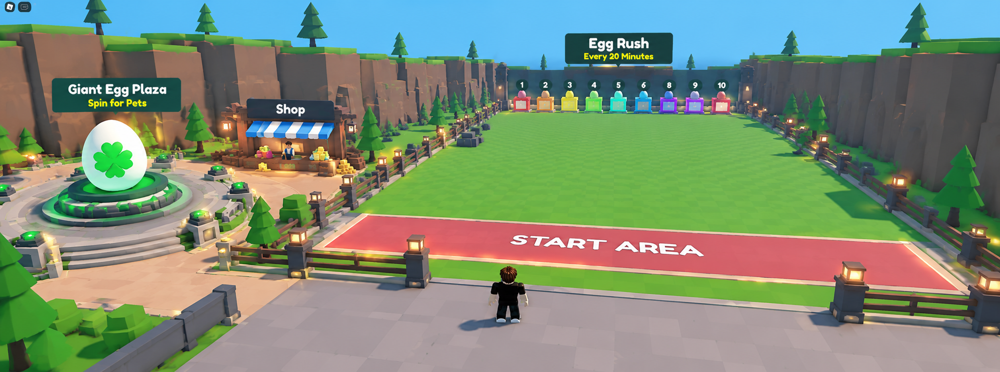
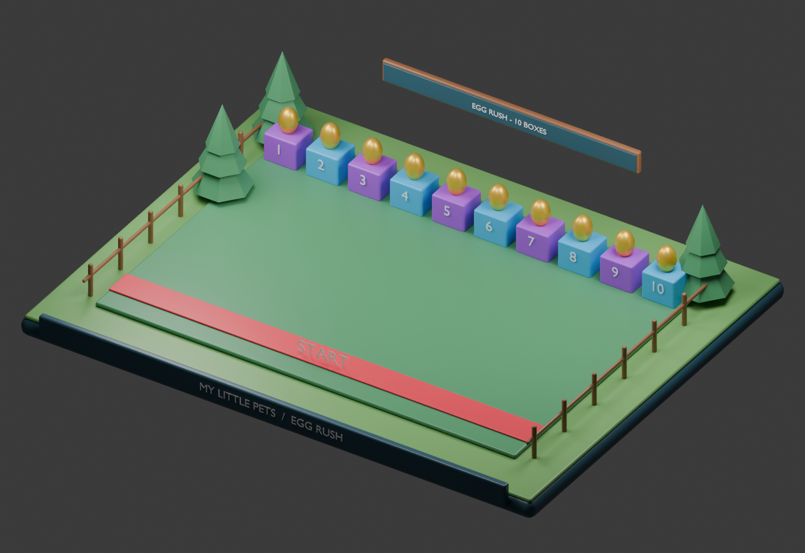

# MY LITTLE PETS

## System 5 — Mini-Field & Egg Rush PvP System

## Specification status and dependencies

This is a development context document, not a claim of implemented Roblox gameplay. Rules inherited from the master concept remain the baseline. Any section labeled proposed or prototype is a concrete playtest recommendation and must be balanced before release. Unapproved monetization, Divine access, Huge acquisition, and future content remain explicitly gated.

All permanent changes are server-authoritative and saved in a versioned player profile. Failed profile loads must block spending and grants rather than overwrite real progress with defaults. Use bounded retries, session ownership, idempotent transaction IDs, and migration checks. Clients handle presentation and submit requests, never final rewards or balances.

## Purpose and fixed fairness rules

Egg Rush is an optional competition every 20 minutes in a rectangular Mini-Field. Players start together and race to ten egg boxes in one straight row. Bats knock opponents backward. All players use identical speed, range, cooldown, hitbox, and knockback regardless of pets, purchases, or bat skin. No EXCLUSIVE rewards come from normal Egg Rush.

## Event lifecycle

Use server states Idle → Registration → Teleporting → Countdown → Running → Results → Returning → Idle. A proposed registration lasts 30 seconds, followed by the required five-second countdown, a maximum 60-second race, and a five-second results display. These timing defaults extend the approved 20-minute cadence for playtesting. Missed rounds do not queue multiple events after server downtime.

Save each entrant's safe return location and current movement settings. Lock entrants behind a starting barrier during countdown. Enable combat only when Running begins. End when all boxes are claimed or the timer expires. Restore world movement rules and return entrants safely even after death, reset, or early exit. Cancel an empty registration without consuming player resources.

## Proposed egg claim mechanic

Use instant claim for the sample implementation: a player within six studs holds an interaction for 0.75 seconds. Taking a valid hit or leaving the radius interrupts the hold. The server atomically grants the first completed valid claim, locks the box, and creates a persistent pending egg reward. Maximum one box per player per round; extra entrants may finish without a reward. Box assignment is determined by server completion order, never client timestamps. Unclaimed boxes expire at round end.

Pending rewards reserve a claim even if inventory is full and can be opened later from a reward inbox. Convert each pending egg into its configured standard biome pet using a unique round/box claim key. Retries and reconnects must not duplicate rewards. Carry-to-safe-zone mechanics are outside this proposed baseline.

## Prototype combat specification

Use uniform speed 16 studs/second, range 6 studs, swing cooldown 0.8 seconds, and a short equal knockback impulse as playtest values. Validate attacker/target participation, state, distance, facing, and cooldown on the server. Limit repeated hits with a proposed 0.5-second victim grace period. Cosmetic meshes never define the hitbox. Bats do not deal health damage and cannot hit spectators or players in the main world.

Disable rarity movement bonuses and farming pet effects in the arena. Farming multipliers, Lucky Boosters, Huge size, variants, and mutations have no influence on combat or claim speed. Restore the highest equipped rarity's world speed on return rather than assuming every player had the same original speed.

## Arena and interface

Build an unobstructed grass rectangle, fenced boundaries, a full-width start line, readable box numbers 1–10, and a spectator edge outside combat bounds. Space spawn slots fairly across the same line. Show the next event timer, optional Join button, countdown, boxes remaining, claim progress, and result. The supplied concept image omits one physical box and skips numbering; the Blender sample and implementation must contain exactly ten.

## Rewards and persistence

Use a separately configured standard-pet reward pool; any Divine reward must obey the approved daily-limited rule. Until that rule is approved, exclude Divine from the prototype pool along with EXCLUSIVE. Arena rewards do not require the winner to unlock a future biome: keep the launch reward pool Forest-only. Weekly Admin Abuse summons are a separate event with distinct configuration.

## Acceptance checks

- Ten boxes spawn with unique consecutive numbers.
- Countdown prevents movement and premature claims.
- Two simultaneous claims award one persistent reward.
- Purchases and every cosmetic bat produce identical PvP behavior.
- Full inventory, disconnect, reset, and event cancellation preserve rewards and restore safe state.
- Invalid swing and claim requests cannot affect nonparticipants.

## Art deliverables

Create arena boundary modules, starting stripe, ten numbered egg boxes, equal-footprint cosmetic bats, countdown overlay, and reward reveal. The Blender sample provides the actual ten-box arena layout, with a separate bat reference sheet for appearance.

## Local images and editable Blender sample

The render is generated from [the editable Blender scene](images/egg-rush.blend). See [image context](images/README.md) for art intent, reference limitations, and reproduction instructions.
