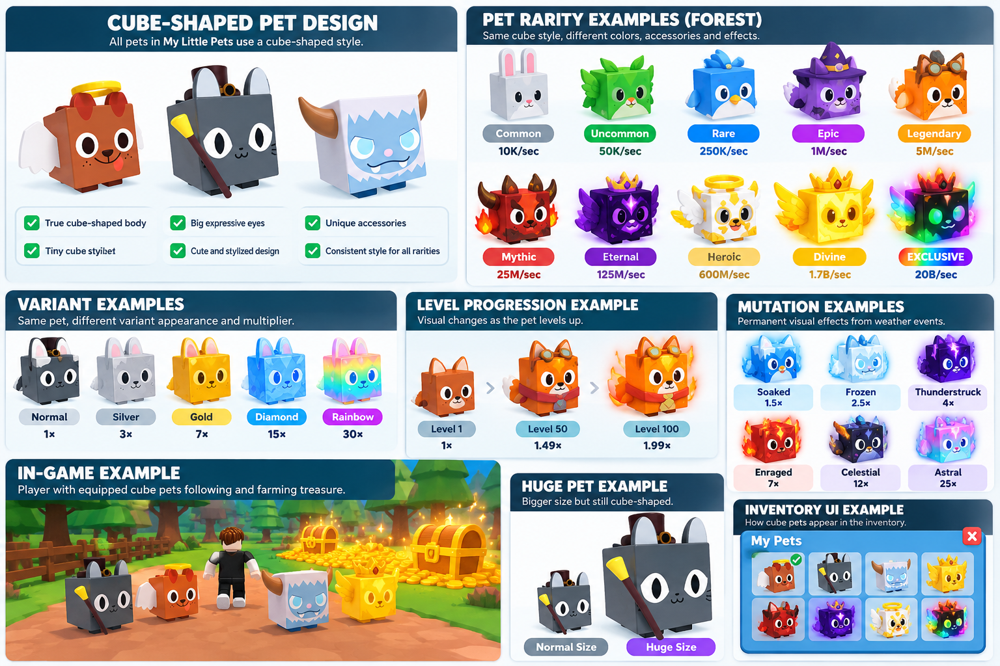
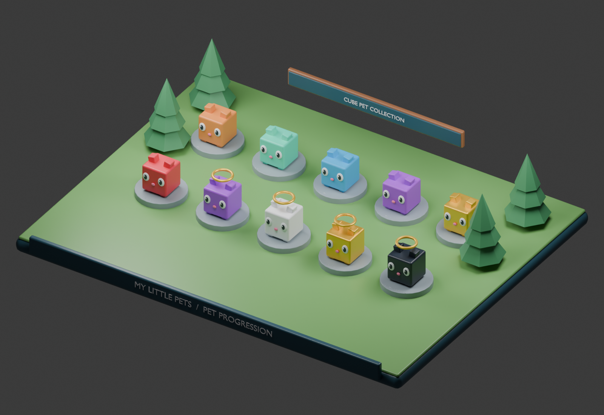

# MY LITTLE PETS

## System 1 — Pet Collection & Progression System

Complete Game Development Specification • Roblox Studio • Luau

### 1. System overview

The Pet Collection & Progression System is responsible for creating, collecting, owning, equipping, leveling, feeding, upgrading, and permanently saving pets in My Little Pets.

Every player begins with one free starter pet and gradually builds a collection of increasingly powerful pets through egg spins, Egg Rush, special events, and premium purchases.

The most important visual requirement is that every pet must be cube-shaped, matching the reference image you provided. This design rule applies to every rarity, biome, variant, mutation, and Huge pet.

Official Pet Design Standard

Cute, stylized 3D cubic pets with square bodies, expressive cartoon faces, tiny feet, and small decorative accessories.


Illustrative style reference. The user's provided image remains the primary visual reference.

## 2. Cube-shaped pet design system

All pet models must use the same consistent geometric design language.

| Component              | Required design                       |
| ---------------------- | ------------------------------------- |
| Main body              | True 3D cube                          |
| Width / Height / Depth | Approximately equal                   |
| Head                   | Integrated into the cubic body        |
| Eyes                   | Large, expressive, cartoon-style      |
| Mouth                  | Small, cute expressions               |
| Feet                   | Tiny block-shaped feet                |
| Ears                   | Small cubic or stylized attachments   |
| Wings                  | Small decorative attachments          |
| Horns                  | Short, stylized geometry              |
| Tail                   | Compact, low-poly                     |
| Accessories            | Halos, crowns, hats, or magical items |
| Materials              | Smooth, bright, stylized              |
| Silhouette             | Recognizably cubic at every rarity    |

### Mandatory modeling rules

- Every pet must have a dominant cube-shaped body.
- No realistic animal anatomy.
- No spherical or elongated main bodies.
- Accessories must not overpower the cube silhouette.
- Each animal should remain recognizable through its ears, face, tail, horns, wings, or markings.
- Higher rarity means richer decoration and effects, not abandoning the cube shape.
- Huge pets are enlarged cubic pets.

### Example pet appearance by rarity


Common

Simple cube fox

Epic

Magical cubic owl


Divine

Radiant cubic dragon

These are illustrative examples, not the finalized pet roster.

## 3. Pet rarity system

The game contains ten rarity classifications, with increasingly powerful base farming income.

| Rarity    | Forest base income | Visual theme            |
| --------- | ------------------ | ----------------------- |
| Common    | 10K/sec            | White / Gray            |
| Uncommon  | 50K/sec            | Green                   |
| Rare      | 250K/sec           | Blue                    |
| Epic      | 1M/sec             | Purple                  |
| Legendary | 5M/sec             | Orange                  |
| Mythic    | 25M/sec            | Red                     |
| Eternal   | 125M/sec           | Violet gradient         |
| Heroic    | 600M/sec           | Pearl-white / Pale Gold |
| Divine    | 1.7B/sec           | Radiant Gold            |
| EXCLUSIVE | 20B/sec            | Animated Rainbow        |

These values represent Normal, Level 1 Forest pets before other bonuses.

EXCLUSIVE pets are separate from ordinary biome egg collections.

### Rarity appearance rules

Rarity determines the visual presentation of a pet's inventory tile, effects, and optional decorative details.

For example, Common pets may have simple faces and subtle colors, while Divine pets may feature golden particles, a glowing halo, and luminous eyes.

However, every pet retains the same cube-shaped main body, regardless of rarity.

## 4. Pet collection distribution

Each biome contains 30 distinct standard collectible pets.

| Rarity    | Forest | River | Desert | Ice | Volcanic |
| --------- | ------ | ----- | ------ | --- | -------- |
| Common    | 5      | 5     | 5      | 5   | 5        |
| Uncommon  | 5      | 5     | 5      | 5   | 5        |
| Rare      | 4      | 4     | 4      | 4   | 4        |
| Epic      | 4      | 4     | 4      | 4   | 4        |
| Legendary | 3      | 3     | 3      | 3   | 3        |
| Mythic    | 3      | 3     | 3      | 3   | 3        |
| Eternal   | 2      | 2     | 2      | 2   | 2        |
| Heroic    | 2      | 2     | 2      | 2   | 2        |
| Divine    | 2      | 2     | 2      | 2   | 2        |
| Total     | 30     | 30    | 30     | 30  | 30       |

# 30

Pets per biome

# 150

Planned biome pets

# 10

Total rarity tiers

EXCLUSIVE pets are not included in the 150 standard biome pets.

Only the Forest collection is available at launch. Future collections are released with their corresponding biome updates.

## 5. Pet acquisition system

Players obtain cube-shaped pets through the following sources.

| Acquisition source        | Pet availability                         |
| ------------------------- | ---------------------------------------- |
| Starter Pet               | One free starting pet                    |
| Giant Egg Spin Plaza      | Biome-specific normal pets               |
| Egg Rush                  | Regular and potentially high-rarity pets |
| Daily-limited opportunity | Divine pets                              |
| Weekly Admin Abuse Summon | EXCLUSIVE pets                           |
| Robux Shop                | Premium EXCLUSIVE pets                   |

The server determines reward outcomes and validates pet ownership.

Players cannot obtain EXCLUSIVE pets through ordinary coin egg spins or normal Egg Rush.

## 6. Pet Inventory System

The Pet Inventory is the main interface for managing owned pets.

Players should be able to inspect their pets, view progression information, equip or unequip them, and choose which pet to feed.

Each owned pet is a unique instance. Two pets of the same species can have different variants, levels, mutations, and sizes.

### Pet data attributes

| Attribute    | Description                            |
| ------------ | -------------------------------------- |
| Pet UID      | Unique identifier of the owned pet     |
| Species ID   | Identifies the pet's design            |
| Pet Name     | Display name                           |
| Origin Biome | Forest, River, Desert, Ice, Volcanic   |
| Rarity       | Common through EXCLUSIVE               |
| Base Income  | Original farming income                |
| Variant      | Normal, Silver, Gold, Diamond, Rainbow |
| Level        | Current level                          |
| XP           | Experience points                      |
| Mutations    | List of permanent mutations            |
| Size         | Normal or Huge                         |
| Equipped     | Current equipment status               |
| Acquired At  | Acquisition timestamp                  |

### Pet Inventory UI concept

## My Pets

Inventory Preview


Forest Fox

Common • Lv. 1


Mystic Owl

Epic • Lv. 25


Golden Dragon

Divine • Lv. 100

Selected pet

Mystic Owl

Variant

Rainbow • 30×

Level

25 / 100

Mutation

Frozen

Conceptual inventory with illustrative pet names.

## 7. Pet equipment and following system

Players can equip pets from their inventory.

Equipped pets follow their owner and automatically participate in treasure farming.

### Expected behavior

1. Player selects a pet from their inventory.
2. Player presses Equip.
3. The pet appears beside or behind the character.
4. The pet follows the player smoothly.
5. When the player farms treasure, equipped pets participate automatically.
6. Unequipping removes the pet from the active world while retaining ownership.

### Movement and animations

Cube-shaped pets should use simple, lightweight animations:

- Gentle bouncing while moving.
- Subtle idle floating.
- Small tilts during movement.
- Blinking and expressive facial changes.
- Short attack or impact motions when farming treasure.

Pets should avoid excessive physics simulation, especially when many players have multiple pets equipped.

The maximum number of equipped pets is not yet finalized.

## 8. Pet variant system

Variants are permanent pet attributes that improve farming income and change appearance.

| Variant | Farming multiplier | Suggested visual style |
| ------- | ------------------ | ---------------------- |
| Normal  | 1×                 | Original pet colors    |
| Silver  | 3×                 | Metallic silver        |
| Gold    | 7×                 | Metallic gold          |
| Diamond | 15×                | Crystalline blue       |
| Rainbow | 30×                | Animated multicolor    |

Variants apply to the entire cube-shaped body, while retaining recognizable animal features.

### Example

A Normal Forest Divine pet earns:

\\[ 1.7B/sec \\]

A Rainbow Forest Divine pet earns:

\\[ 1.7B\times30=51B/sec \\]

A Rainbow variant is different from EXCLUSIVE rarity.

## 9. Pet Leveling System

Pets improve through experience points.

There are two primary ways to earn XP:

Active farming: Equipped pets gain XP through farming coin piles, treasure hoards, and chests.

Feeding: Players consume food items to grant XP directly to selected pets.

### Proposed level structure

Maximum level: 100.

Each level above Level 1 increases farming income by 1%.

| Level | Farming multiplier |
| ----- | ------------------ |
| 1     | 1×                 |
| 10    | 1.09×              |
| 25    | 1.24×              |
| 50    | 1.49×              |
| 75    | 1.74×              |
| 100   | 1.99×              |

The XP requirements per level still need balancing.

Level progression is permanent per individual pet.

## 10. Pet Feeding System

Feeding provides an alternative way to improve pets without relying entirely on automatic farming.

### Proposed food items

| Food         | XP     |
| ------------ | ------ |
| Apple        | 100    |
| Fish         | 500    |
| Golden Fruit | 2,500  |
| Mystic Treat | 10,000 |

### Feeding sequence

1. Open Pet Inventory.
2. Select an owned pet.
3. Select Feed.
4. Choose an available food item.
5. The server verifies the food quantity.
6. The food is consumed and XP is granted.
7. The pet levels up when enough XP is reached.
8. Updated progression is saved.

Food acquisition methods and prices remain undecided.

## 11. Pet movement-speed bonuses

Higher-rarity equipped pets can improve player movement speed in the main farming world.

### Proposed bonuses

| Highest equipped rarity | Speed bonus |
| ----------------------- | ----------- |
| Common                  | 0%          |
| Uncommon                | +3%         |
| Rare                    | +6%         |
| Epic                    | +9%         |
| Legendary               | +12%        |
| Mythic                  | +15%        |
| Eternal                 | +18%        |
| Heroic                  | +21%        |
| Divine                  | +24%        |
| EXCLUSIVE               | +30%        |

Only the highest equipped rarity contributes to movement speed.

These bonuses are disabled in Egg Rush, preserving equal player speed.

## 12. Pet Mutation System integration

Pets can receive permanent mutations when directly struck by qualifying weather effects.

| Mutation      | Farming multiplier |
| ------------- | ------------------ |
| Soaked        | 1.5×               |
| Frozen        | 2.5×               |
| Thunderstruck | 4×                 |
| Enraged       | 7×                 |
| Celestial     | 12×                |
| Astral        | 25×                |

Mutations affect pet farming income and can also alter the cube pet's materials, colors, particles, or environmental effects.

For example, a Frozen cube pet may have icy highlights, while a Thunderstruck pet may produce small electric sparks.

### Mutation rules

- Mutations are permanent.
- Direct weather strikes are required.
- Mutation rolls may fail.
- Pets can have multiple distinct mutations.
- Duplicate mutations on the same pet are prohibited.
- Mutation limits and stacking formulas remain to be finalized.

The Weather Events & Mutation System controls weather generation and mutation success calculations.

## 13. Huge Pet System

Huge is a pet size classification rather than a rarity.

Huge pets retain the same cubic design as normal pets but are scaled up significantly.

### Huge pet requirements

- The main body remains cube-shaped.
- Facial proportions remain cute and expressive.
- Huge pets retain their original rarity.
- Variants and mutations still apply.
- Huge pets can participate in farming.
- Sufficiently powerful Huge Mutated EXCLUSIVE pets can one-hit the strongest treasure targets.
- Huge pets do not bypass locked sectors or create Egg Rush PvP advantages.

Huge pet acquisition and size multipliers are still undecided.

## 14. Origin-biome progression

Pets of the same rarity can have different base income depending on their origin biome.

The current proposed scaling is:

| Biome    | Income multiplier |
| -------- | ----------------- |
| Forest   | 1×                |
| River    | 2×                |
| Desert   | 4×                |
| Ice      | 8×                |
| Volcanic | 16×               |

For example, a Normal Level 1 Divine pet would earn 1.7B/sec in Forest and 3.4B/sec if obtained from River.

These biome multipliers are proposed and not yet finalized.

All biome pets must follow the same cube-shaped visual design.

## 15. Farming income integration

The pet system provides the data required by the Treasure Farming & Economy System.

The working formula is:

\\[ \text{Pet Income}=B\times W\times V\times M\times L\times P \\]

| Symbol | Meaning                              |
| ------ | ------------------------------------ |
| B      | Base pet rarity income               |
| W      | Origin-biome multiplier              |
| V      | Pet variant multiplier               |
| M      | Combined mutation multiplier         |
| L      | Pet level multiplier                 |
| P      | Permanent account farming multiplier |

The Robux farming multiplier is permanently owned by the player, not attached to an individual pet.

It continues beyond 4,096× as new upgrade tiers are released, without resetting or requiring repurchases.

## 16. Data persistence and anti-exploit security

Pet ownership and progression must be saved using Roblox DataStores.

Each pet's saved data includes its unique identifier, species, origin biome, rarity, variant, level, XP, mutation list, size classification, and equipment state.

The server must control and validate pet grants, ownership transfers if trading is later introduced, XP awards, feeding, mutation grants, and farming income.

The client may display animations and interface updates, but it must not be trusted to determine rewards or permanent progression.

## 17. Recommended technical architecture

Pet Definitions

Species • Rarity • Cube Model • Base Income

Pet Service

Ownership • Equipment • Progression

Pet Visuals

Cube Models • Following • Animation

Persistent Player Data

Inventory • XP • Variants • Mutations • Equipped Pets

### Suggested Roblox Studio structure

```
ReplicatedStorage/
├── Shared/
│   ├── PetDefinitions
│   ├── PetRarities
│   ├── PetVariants
│   └── PetLevelConfig
├── Remotes/
│   ├── EquipPet
│   ├── UnequipPet
│   └── FeedPet
└── PetModels/
    └── Forest/
        ├── Common/
        ├── Uncommon/
        ├── Rare/
        ├── Epic/
        ├── Legendary/
        ├── Mythic/
        ├── Eternal/
        ├── Heroic/
        └── Divine/

ServerScriptService/
├── Services/
│   ├── PetService
│   ├── PetEquipmentService
│   ├── PetLevelService
│   └── PlayerDataService

StarterPlayer/
└── StarterPlayerScripts/
    ├── PetFollowController
    └── PetAnimationController

StarterGui/
└── PetInventoryGui
```

All pet models in `PetModels` must use cube-shaped bodies.

## 18. System 1 development checklist

## System 1 Checklist

0 / 17

Create standardized cube-shaped pet model template

Define rarity and base farming income

Design 30 Forest pet species

Create PetDefinitions configuration

Implement unique pet ownership

Implement Pet Inventory interface

Implement pet equip and unequip

Implement cube pet following and animations

Implement pet variants

Implement pet XP and leveling

Implement pet feeding

Implement movement-speed bonuses

Integrate permanent weather mutations

Integrate Huge pet classification

Implement farming income attributes

Implement DataStore persistence

Implement server-side validation

Planning checklist; it does not reflect completed implementation unless you mark items yourself.

## 19. Completion criteria

System 1 is complete when a player can receive a starter pet, obtain additional cube-shaped pets, manage their inventory, equip and unequip pets, see them follow the character, improve them through farming and feeding, obtain variants and permanent mutations, and retain all progression after leaving and rejoining.

The cube-shaped body is a mandatory art requirement, not an optional visual preference. Every future pet model must follow the same recognizable cubic silhouette.

This system provides the pet ownership and progression foundation required by the other six major game systems.
## Specification status and dependencies

This is a development context document, not a claim of implemented Roblox gameplay. Rules inherited from the master concept remain the baseline. Any section labeled proposed or prototype is a concrete playtest recommendation and must be balanced before release. Unapproved monetization, Divine access, Huge acquisition, and future content remain explicitly gated.

All permanent changes are server-authoritative and saved in a versioned player profile. Failed profile loads must block spending and grants rather than overwrite real progress with defaults. Use bounded retries, session ownership, idempotent transaction IDs, and migration checks. Clients handle presentation and submit requests, never final rewards or balances.

## Local images and editable Blender sample





The render is generated from [the editable Blender scene](images/pet-progression.blend). See [image context](images/README.md) for art intent, reference limitations, and reproduction instructions.

## Proposed prototype decisions supplement

Start with three equipment slots and 200 inventory slots, with one free Level 1 Normal Common Forest Fox granted exactly once. Add the starter species to discovery. Use XP-to-next-level = 100 × current level, reset within-level XP on each level-up, carry overflow forward, and cap at Level 100. Reaching 100 requires 495,000 cumulative XP. Grant one XP per second of validated active farming per equipped working pet, independent of payout multipliers.

Proposed food coin prices are Apple 100K, Fish 500K, Golden Fruit 2.5M, and Mystic Treat 10M, for the existing 100 / 500 / 2,500 / 10,000 XP values. Reject feeding a capped pet before consuming food. Use additive mutation bonuses and a maximum of six distinct types as described in the Weather specification. Huge remains visually supported with a default strength factor of 1 until acquisition and strength are approved. Variants remain modeled attributes; do not expose an unapproved paid variant-conversion flow.

### Proposed 30-species Forest roster

These names are new art direction proposals, not approved character assets. Common: Forest Fox, Meadow Bunny, Acorn Mouse, Moss Chick, Twig Pup. Uncommon: Leaf Cat, Clover Deer, Fern Frog, Sprout Owl, Hedgehog Scout. Rare: Azure Jay, Crystal Badger, Riverbank Otter, Sapphire Squirrel. Epic: Mystic Owl, Mooncap Cat, Orchid Moth, Rune Wolf. Legendary: Amber Griffin, Suncrest Lion, Ancient Stag. Mythic: Ember Imp, Crimson Drake, Thorn Phoenix. Eternal: Twilight Lynx, Void Raven. Heroic: Halo Hound, Pearl Pegasus. Divine: Golden Dragon, Crowned Seraph. Every design retains a dominant cube-shaped body. Store stable species IDs independently from names.

### Cross-system precedence

The starter and standard collection exclude EXCLUSIVE. Divine acquisition stays behind its separate daily-limited opportunity until its limits are approved. Use the shared farming rate formula and mutation policy, rather than multiplying cached values repeatedly. Main-world rarity speed bonuses are disabled in Egg Rush. Complete Index rewards from permanent species discoveries, not the number of currently owned pets.
