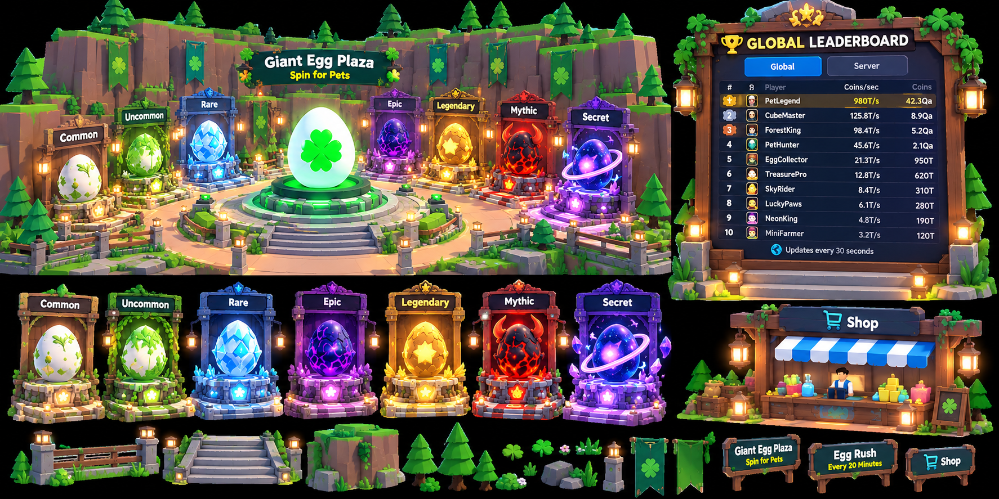
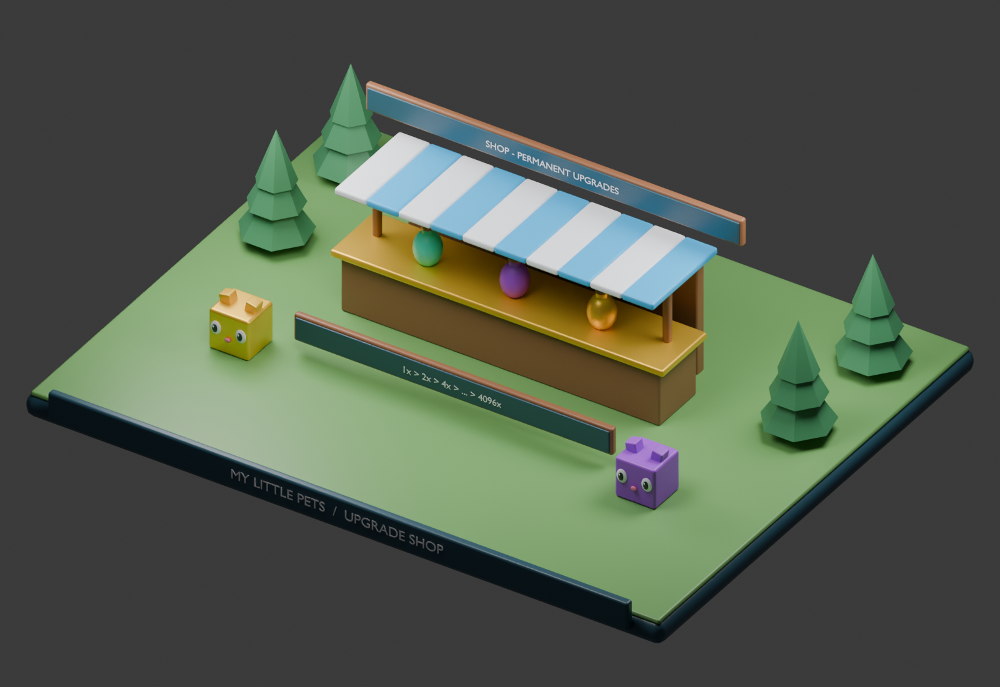

# MY LITTLE PETS

## System 7 — Robux Shop & Permanent Upgrade System

## Specification status and dependencies

This is a development context document, not a claim of implemented Roblox gameplay. Rules inherited from the master concept remain the baseline. Any section labeled proposed or prototype is a concrete playtest recommendation and must be balanced before release. Unapproved monetization, Divine access, Huge acquisition, and future content remain explicitly gated.

All permanent changes are server-authoritative and saved in a versioned player profile. Failed profile loads must block spending and grants rather than overwrite real progress with defaults. Use bounded retries, session ownership, idempotent transaction IDs, and migration checks. Clients handle presentation and submit requests, never final rewards or balances.

## Purpose and permanent entitlements

The shop offers sequential permanent farming upgrades, premium EXCLUSIVE pets, and mutation Lucky Boosters. Farming upgrades belong to the account, never expire, survive future biomes, and never require repurchasing an owned tier. No shop product improves Egg Rush speed, knockback, hitbox, range, cooldown, or claim speed.

## Approved target price ladder

Start at 1× for free. Sequential tier multiplier / target Robux price pairs are 2× / 2, 4× / 5, 8× / 9, 16× / 15, 32× / 25, 64× / 39, 128× / 59, 256× / 89, 512× / 129, 1,024× / 179, 2,048× / 249, and 4,096× / 349. The full target ladder totals 1,149 Robux, matching the master overview. These are design target prices, not a claim that products are configured or published.

Always show current multiplier, next multiplier, exact available platform price, permanence, and a clear purchase button. The next tier doubles the current multiplier; it is a replacement factor rather than an additional independent bonus. Buying 4× after 2× results in 4× total, not 8×.

## Future expansion

Forest launch caps available tiers at 4,096×. Planned later caps are River 16,384×, Desert 65,536×, Ice 262,144×, and Volcanic 1,048,576×. Each expansion adds sequential doublings. Prices for tiers beyond launch remain a product decision; keep unreleased tiers informational and unpurchasable. Old entitlements carry forward unchanged.

## Receipt and entitlement contract

Use a centralized server purchase adapter; bind configured platform product IDs to explicit entitlement grants. The client purchase prompt is never evidence of payment. Validate the actual server receipt or entitlement ownership before granting. Record receipt IDs alongside the grant transaction and make fulfillment idempotent so retries cannot duplicate consumables or pets.

For sequential upgrades, configure permanent ownership products per tier and reconcile owned tiers on join. The UI only offers the next tier. Never consume a paid valid entitlement because an earlier ownership check arrived late: reconcile the highest verified permanent tier and log ordering anomalies. For repeatable pets and boosters, use receipt-based consumable fulfillment and a persistent pending-grant record if inventory cannot accept a reward. A shop failure must preserve the player's current tier and all existing purchases.

## Lucky Boosters

Basic, Super, and Ultra Lucky last five minutes and add proposed bonuses of 5, 15, and 25 percentage points to a qualifying mutation roll. Only one is active at a time. The shop must state that a direct weather hit is required and success is not guaranteed. Pricing is not approved; display Coming Soon in sample UI rather than invented purchase prices. The Weather system owns activation and expiry semantics.

## EXCLUSIVE and special events

EXCLUSIVE has a Forest reference base of 20B/sec and animated rainbow presentation. It is separate from the 30-pet biome index and never enters ordinary egg pools. Premium species, prices, variant rules, and Huge availability are not approved. Weekly Admin Abuse summons use a separate free event configuration and announcement; exact schedule and odds remain a release gate. Sample art may show an EXCLUSIVE preview without suggesting it is purchasable now.

## Interface and failure states

Separate Permanent Upgrades, Premium Pets, and Boosters. Show owned/current state, pending purchase, completed fulfillment, cancelled prompt, unavailable product, and retryable service error. Disable duplicate purchase requests while pending. The selected bat skin is never a paid combat tier. Preserve price localization and live product metadata rather than treating concept art numbers as a checkout authority.

## Data and acceptance checks

Save verified tier ownership, receipt/grant IDs, booster inventory, premium pet UIDs, and pending grants. Test repeated receipts, reconnect during purchase, delayed ownership reconciliation, unavailable profile, full inventory, cancelled prompt, and future tier rollout. A confirmed grant must survive rejoin; an unconfirmed client prompt must grant nothing. Check that the 12 launch target prices sum to 1,149 and all multiplier values equal powers of two.

## Art deliverables

Create a forest wooden shop kiosk, blue-and-white awning, upgrade badge, potion previews, premium pet display, and clear owned/current indicators. The Blender sample includes a kiosk, booster bottles, and upgrade display. Final checkout prices come from verified configured products rather than image text.

## Local images and editable Blender sample

The render is generated from [the editable Blender scene](images/upgrade-shop.blend). See [image context](images/README.md) for art intent, reference limitations, and reproduction instructions.
