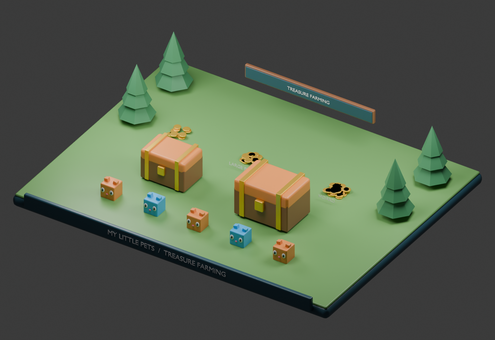

# MY LITTLE PETS

## System 3 — Treasure Farming & Economy System

## Specification status and dependencies

This is a development context document, not a claim of implemented Roblox gameplay. Rules inherited from the master concept remain the baseline. Any section labeled proposed or prototype is a concrete playtest recommendation and must be balanced before release. Unapproved monetization, Divine access, Huge acquisition, and future content remain explicitly gated.

All permanent changes are server-authoritative and saved in a versioned player profile. Failed profile loads must block spending and grants rather than overwrite real progress with defaults. Use bounded retries, session ownership, idempotent transaction IDs, and migration checks. Clients handle presentation and submit requests, never final rewards or balances.

## Purpose and boundaries

Equipped cube pets automatically farm coin piles, giant hoards, and treasure chests in unlocked sectors. This system owns target durability, coin payout, replenishment, and numeric formatting. Scenery remains intact. All biomes use the same Coins wallet despite different coin art.

## Farming calculation

For each equipped pet, compute rate = base rarity income × origin-biome factor × variant factor × combined mutation factor × (1 + 0.01 × (level - 1)) × permanent account factor. Add pet rates to obtain the team's nominal coins per second. Huge strength is a separately configured factor and defaults to 1 until approved. Never apply origin scaling twice if a stored base value already includes it.

Normal Forest Level 1 base rates are Common 10K, Uncommon 50K, Rare 250K, Epic 1M, Legendary 5M, Mythic 25M, Eternal 125M, Heroic 600M, Divine 1.7B, and EXCLUSIVE 20B per second. Variant factors are Normal 1, Silver 3, Gold 7, Diamond 15, and Rainbow 30.

## Target lifecycle and payout contract

Proposed prototype contract: durability is measured in coin-work units. Each server tick removes min(team rate × elapsed time, remaining durability) from a target and credits that exact amount as coins. A target therefore has a fixed maximum total payout equal to its initial durability. This avoids granting both periodic income and a second full chest reward on depletion. Award XP only for validated active work.

Multiple teams share one target's remaining work; apportion a tick's remaining durability by requested work so the last tick never overpays. Keep fractional progress internally, credit whole coins, and retain the fractional remainder per player. Pets choose a reachable target in range in an unlocked sector; after depletion select another target or idle. No target means no farming payout.

## Prototype target configuration

For Forest Entrance, start with small pile 100K work / 3-second respawn, large pile 500K / 5 seconds, hoard 2M / 8 seconds, and wooden chest 10M / 12 seconds. Later sector target work scales provisionally by 10 per sector. These are playtest proposals. Tune target density and replenishment so powerful teams have useful targets without infinite instant payout loops. A one-hit pet still earns only the remaining target value.

## Economy sinks and presentation

Coin sinks are egg spins, sequential sector gates, and proposed food purchases. Do not charge coins for permanent cosmetic bat claims. Display K, M, B, T, Qa and larger suffixes with consistent rounding; keep the exact balance available in a detail view. Nominal team rate is potential farming output, while earned coins reflect real available target work.

Use an explicit large-number representation for balances and rates before values exceed exact integer precision. Persist a versioned decimal-string or mantissa/exponent format rather than silently truncating large values. Rounding on screen must never determine affordability. Cap elapsed time for farming ticks to prevent a long pause from becoming unbounded income; offline income is outside the current design.

## Leaderboards

The supplied board references show global and current-server rankings with coins/sec and Coins columns. Rank by server-calculated nominal team rate, with a stable user-ID tiebreaker. Show cached data and update timestamps. Prototype refresh targets are 30 seconds globally and 5 seconds locally; these are display goals, not guarantees. Throttle writes and show an unavailable state when ranking storage fails. Never let board errors block farming.

## Data and implementation ownership

Treasure definitions store target ID, sector, initial work, respawn delay, and visual model. TreasureService owns target state; FarmingService owns assignment and tick allocation; EconomyService owns balance changes; leaderboard and visual controllers consume sanitized snapshots. Save wallet and persistent progression, not each short-lived target. Validate distance, equipment ownership, sector access, and target life state server-side.

## Acceptance checks

- A 10K/sec starter earns 10K from one second of valid work.
- A 100K target pays at most 100K total across all contributors.
- Depleted targets shrink, disappear, and respawn without duplicate payouts.
- Pet swaps, mutations, and purchases update rate once.
- Teleporting into a locked sector never authorizes farming there.
- Extremely large values retain affordability and display correctly.

## Art deliverables

Create small and large leaf-engraved gold piles, a giant hoard, wooden chest, and golden chest. Keep collision simple and use staged scale changes rather than complex destruction. The Blender sample presents reusable treasure and cube pets on a forest diorama.

## Local images and editable Blender sample

The render is generated from [the editable Blender scene](images/treasure-farming.blend). See [image context](images/README.md) for art intent, reference limitations, and reproduction instructions.
