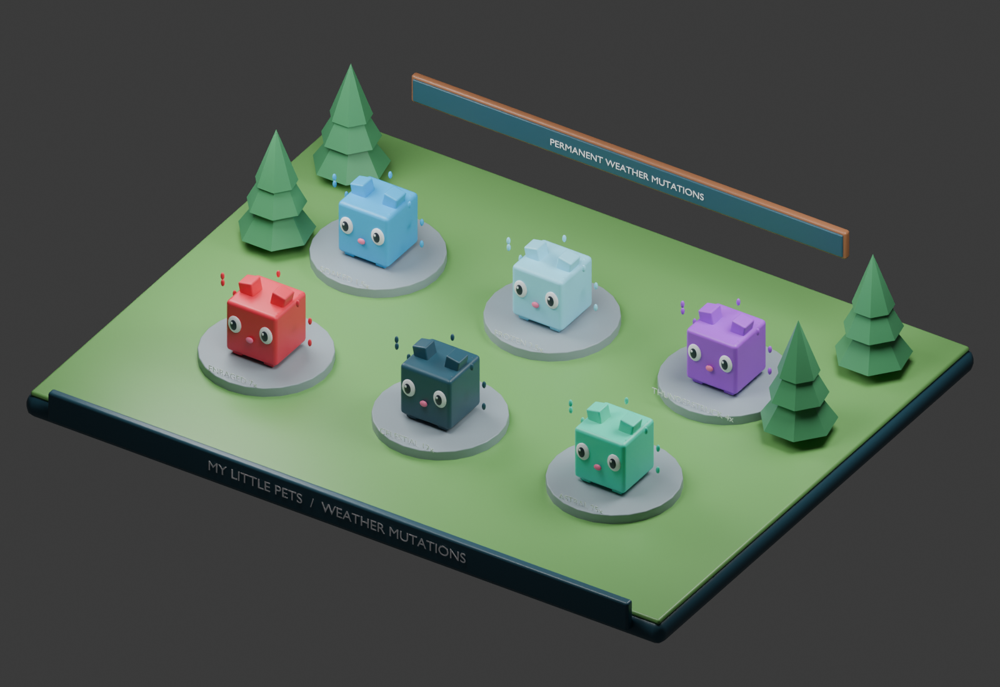

# MY LITTLE PETS

## System 6 — Weather Events & Mutation System

## Specification status and dependencies

This is a development context document, not a claim of implemented Roblox gameplay. Rules inherited from the master concept remain the baseline. Any section labeled proposed or prototype is a concrete playtest recommendation and must be balanced before release. Unapproved monetization, Divine access, Huge acquisition, and future content remain explicitly gated.

All permanent changes are server-authoritative and saved in a versioned player profile. Failed profile loads must block spending and grants rather than overwrite real progress with defaults. Use bounded retries, session ownership, idempotent transaction IDs, and migration checks. Clients handle presentation and submit requests, never final rewards or balances.

## Purpose and permanent outcomes

Random weather exposes equipped pets to direct-hit mutation rolls. Standing in a weather event alone never grants a mutation. Successful mutations are permanent per pet, distinct mutations can accumulate, and duplicates are forbidden. Weather changes farming appearance and output without influencing Egg Rush fairness.

## Event definitions

Rainy produces Soaked at 1.5×, Snowstorm produces Frozen at 2.5×, Thunderstorm produces Thunderstruck at 4×, Rage produces Enraged at 7×, Meteor Shower produces Celestial at 12×, and Aurora produces Astral at 25×. Keep a stable mutation ID separate from its display name. Preserve these approved individual factors.

## Proposed scheduler and strike model

For the sample, schedule one two-minute weather event after a random 8–12 minute clear interval. Pick weather with provisional weights Rainy 40, Snowstorm 25, Thunderstorm 18, Rage 10, Meteor Shower 5, and Aurora 2 out of 100. Do not overlap weather events. These timing and frequency values are playtest proposals.

During an event, every ten seconds choose up to three eligible equipped pets per server, uniformly without replacement. Produce a visible effect that directly contacts each chosen pet, then roll mutation success on the server. Eligibility requires a loaded owner profile, an active pet in an unlocked world sector, and absence of that mutation. Pets in the Mini-Field, inventory, or another server are excluded. Limit a pet to one roll per strike ID; visual replay never repeats the roll.

## Success and booster rules

Use a provisional base chance of 5% per qualifying direct hit. Basic, Super, and Ultra Lucky add 5, 15, and 25 percentage points respectively for five minutes, yielding 10%, 20%, and 30% with the sample base. Clamp success to 100%. Only one booster is active; reject activation while another remains active. Consume a booster and record its end time atomically. Proposed timer semantics use an absolute UTC expiry that continues while offline; show this before activation.

Boosters do not create strikes, change event frequency, guarantee mutations, or affect egg odds or PvP. Only a qualifying pet owned by the boosted player receives the chance bonus.

## Proposed stacking decision

For the sample use additive bonus stacking: combined factor = 1 + sum(individual factor - 1). Soaked plus Frozen gives 3×, not 3.75×. All six distinct mutations give 47×. Permit all six types and no duplicates. This is a new balancing proposal resolving an earlier open question, not an approved rule. Use one shared configurable formula in the pet detail UI and farming calculation so playtests can change it safely.

## Visual and audio behavior

Give each weather a readable sky tint, lightweight ambient particles, strike cue, and a success notification naming the pet and mutation. Soaked uses droplets; Frozen uses frost; Thunderstruck uses sparks; Enraged uses ember accents; Celestial uses star fragments; Astral uses soft aurora ribbons. Preserve the cube silhouette and rarity identity beneath overlays. Support reduced effects and avoid rapid full-screen flashes. A failed strike remains visually distinct from a successful permanent mutation.

## Persistence and ownership

WeatherService owns scheduling and strike IDs. MutationService checks eligibility and grants permanent IDs through PetService. BoosterService stores inventory and expiry. Save the mutation list, booster counts, expiry, and grant transaction IDs. Recompute income from definitions after mutation grant; never compound a previously multiplied cached income. Late event messages cannot mutate an unequipped or transferred pet.

## Acceptance checks

- Ambient rain without a direct hit grants nothing.
- A failed roll leaves the pet unchanged.
- Replaying a strike or receiving the same mutation cannot duplicate its bonus.
- Six mutations produce 47× under the proposed additive rule.
- A booster expires correctly after reconnect and cannot overlap another.
- Egg Rush pets receive no strikes or combat advantage.

## Art deliverables

Produce six restrained mutation overlays, six weather cues, strike effects, booster bottle icons, and success/failure notifications. The pet reference sheet establishes mutation colors. The Blender sample shows six cubic pets with distinct weather treatments; procedural effects illustrate appearance rather than a runtime particle implementation.

## Local images and editable Blender sample

The render is generated from [the editable Blender scene](images/weather-mutations.blend). See [image context](images/README.md) for art intent, reference limitations, and reproduction instructions.
