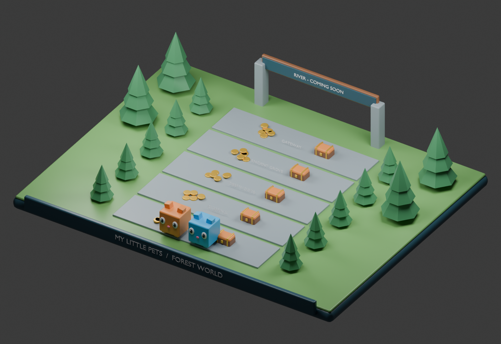

# MY LITTLE PETS

## System 2 — World & Biome Progression System

## Specification status and dependencies

This is a development context document, not a claim of implemented Roblox gameplay. Rules inherited from the master concept remain the baseline. Any section labeled proposed or prototype is a concrete playtest recommendation and must be balanced before release. Unapproved monetization, Divine access, Huge acquisition, and future content remain explicitly gated.

All permanent changes are server-authoritative and saved in a versioned player profile. Failed profile loads must block spending and grants rather than overwrite real progress with defaults. Use bounded retries, session ownership, idempotent transaction IDs, and migration checks. Clients handle presentation and submit requests, never final rewards or balances.

## Purpose and player journey

The world is one connected linear route. The Forest launches first, followed by River, Desert, Ice, and Volcanic updates. Players farm coins, buy the next sector gate, and discover stronger treasure without losing pets or permanent account upgrades.

## Forest layout

The hub contains the spawn, Giant Egg Spin Plaza, shop, leaderboards, Pet Index access, and the Mini-Field entrance. Five farming sectors follow in order: Forest Entrance (free), Green Clearing, Deep Woods, Ancient Grove, and Forest Gateway. Place the River Coming Soon gateway after sector five. The arena is a separate competition space, never a sixth farming sector.

Use broad grassy paths, low-poly trees, stepped cliff walls, wooden fencing, warm lanterns, and readable signs. Keep sight lines clear so players can find gates and treasure on mobile. Decorative trees and rocks are not destructible farming targets.

## Gate interaction

1. Approach a locked gate to see its sector name, coin price, and prerequisite.
2. Request an unlock through a clearly labeled button.
3. The server verifies the previous sector, balance, and active profile.
4. Deduct the price and grant the unlock in one profile transaction.
5. Open the gate for that player and save the result; retries cannot charge twice.

Locked gates remain authoritative even if the client hides a barrier or teleports. Farming checks the player's unlocked sectors rather than trusting character position alone. Existing unlocks remain available after respawn and rejoin.

## Expansion rules

River uses bridges, water, and pearl treasure; Desert uses dunes and ruins; Ice uses glaciers and crystals; Volcanic uses lava and obsidian. Each biome adds 30 standard pets and its own cosmetic coin design, all contributing to one shared Coins balance. Proposed pet origin multipliers are Forest 1, River 2, Desert 4, Ice 8, and Volcanic 16; they apply to pet origin, not the ground currently occupied.

## Interface, persistence, and services

Show the current sector, next gate price, available coins, and locked reason. Unreleased content displays Coming Soon without a purchase button. Save unlocked sector IDs and last safe spawn. WorldService owns gate permissions; EconomyService performs debits; PlayerDataService saves; a client controller handles signs and visual gates. Keep configuration IDs independent from display names.

## Suggested playtest defaults

New proposed values, not previously approved balance: gates cost 2M, 20M, 200M, and 2B coins. Start testing with three equipped Common pets as an attainable early team, while granting only one starter pet. Measure time to each unlock with free and upgraded accounts before publishing prices. Preserve the sequential gate rule even when a purchase makes farming very fast.

## Acceptance checks

- A new account can enter only the free sector.
- Double requests unlock once and spend once.
- Insufficient funds, missing prerequisites, and unreleased biomes reject cleanly.
- Rejoining restores unlocks and a valid spawn.
- Egg Rush return restores the player's safe world location.
- Every future biome preserves previously owned pets and multipliers.

## Art deliverables

Build reusable cliff, grass, fence, lantern, tree, gate, and sign modules. The sample Blender scene demonstrates the five-sector route and River gateway; it is an editable blockout, not the finished Roblox map. The supplied forest reference says Beach Area at the far end; production must use River instead.

## Local images and editable Blender sample

The render is generated from [the editable Blender scene](images/forest-world.blend). See [image context](images/README.md) for art intent, reference limitations, and reproduction instructions.
