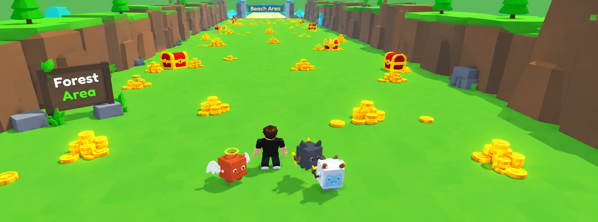
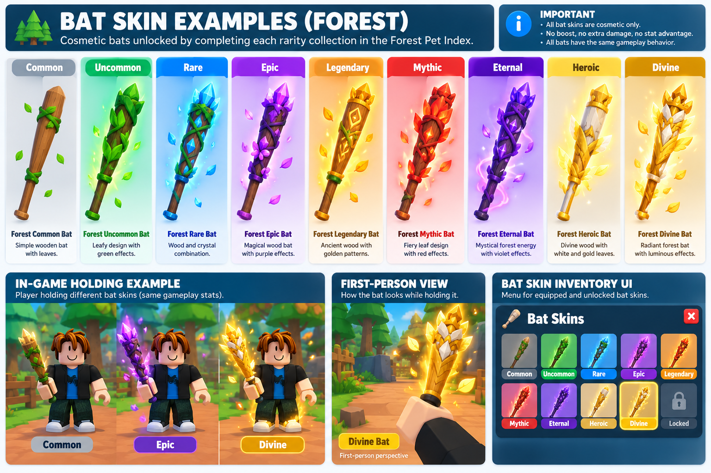

# MY LITTLE PETS

Complete Roblox Game Design Overview — Master Concept v1.0

My Little Pets is a multiplayer Roblox pet simulator combining treasure farming, pet collecting, rarity-based progression, competitive Egg Rush events, permanent weather mutations, cosmetic bat rewards, and permanent Robux farming upgrades.

The main objective is to build an increasingly powerful pet collection while unlocking new farming sectors, competing for valuable eggs, completing the Pet Index, and expanding into future biomes.

11

Treasure Farming

Pet Collection

Egg Rush

Cosmetic Bat Skins

Permanent Progression

## 1. Game identity

 Category              Specification                                               
 --------------------  ----------------------------------------------------------- 
 Game title            My Little Pets                                              
 Platform              Roblox                                                      
 Engine                Roblox Studio                                               
 Programming language  Luau                                                        
 Genre                 Pet Simulator  Farming  Collection  Multiplayer          
 Currency              Coins                                                       
 Premium purchases     Robux                                                       
 Launch biome          Forest                                                      
 World structure       One continuous linear route                                 
 Competitive arena     Mini-Field                                                  
 Main event            Egg Rush, every 20 minutes                                  
 Highest pet rarity    EXCLUSIVE                                                   
 Main monetization     Permanent farming multipliers, premium pets, Lucky Boosters 

## 2. Core gameplay loop

Start with one free pet

Every new player receives a starter pet

Farm valuable treasures

Equipped pets automatically collect coins

Spin giant eggs

Spend coins to obtain stronger pets

Improve and collect pets

Level up, feed, obtain variants and mutations

Complete Pet Index collections

Unlock permanent cosmetic bat skins

Compete in Egg Rush

Race for valuable eggs using cosmetic bats

Unlock sectors and biomes

Progress into increasingly valuable farming areas

Repeat to advance and complete collections

## 3. World and biome progression

The world is a continuous, connected route. Players unlock new sectors using coins, while major biome expansions arrive in future game updates.

 Biome     Release      Environment                        
 --------  -----------  ---------------------------------- 
 Forest    Version 1.0  Forests, greenery, wooden treasure 
 River     Update 1     Rivers, bridges, waterfalls        
 Desert    Update 2     Sand dunes, ancient ruins          
 Ice       Update 3     Snow, glaciers, crystals           
 Volcanic  Update 4     Lava, magma, obsidian              

### Forest sectors

 Sector  Name             Unlock 
 ------  ---------------  ------ 
 1       Forest Entrance  Free   
 2       Green Clearing   Coins  
 3       Deep Woods       Coins  
 4       Ancient Grove    Coins  
 5       Forest Gateway   Coins  

A River Gateway appears at the end of the Forest biome with a Coming Soon sign until River releases.

Later biomes introduce stronger pets, more valuable treasure, and additional farming multiplier tiers.

## 4. Treasure farming system

Players equip pets to automatically farm treasure targets.

Small Coin Pile

Large Coin Pile

Giant Coin Hoard

Treasure Chest

Farming targets have durability, gradually shrink as pets farm them, grant coins, and respawn after depletion.

The game also features biome-specific valuables. Ordinary trees and rocks are not generic destructible farming targets.

### Biome coin identities

 Biome     Coin appearance                       Treasure appearance      
 --------  ------------------------------------  ------------------------ 
 Forest    Gold with leaf engravings             Wooden and golden chests 
 River     Blue-silver with wave symbols         Pearl and aquatic chests 
 Desert    Bronze-gold with ancient symbols      Sandstone chests         
 Ice       Blue translucent crystal coins        Frozen chests            
 Volcanic  Dark metal with glowing magma cracks  Obsidian chests          

All coin designs contribute to one shared currency.

## 5. Giant Egg Spin Plaza

The main base features giant eggs arranged in a semicircle.

Players spend coins earned through farming to spin eggs for pets.

Each biome has its own themed eggs and collection of 30 pets.

EXCLUSIVE pets cannot be obtained from ordinary coin egg spins.

## 6. Pet rarity system

 Rarity     Forest Level 1 base income  Color theme        
 ---------  --------------------------  ------------------ 
 Common     10Ksec                     White  Gray       
 Uncommon   50Ksec                     Green              
 Rare       250Ksec                    Blue               
 Epic       1Msec                      Purple             
 Legendary  5Msec                      Orange             
 Mythic     25Msec                     Red                
 Eternal    125Msec                    Violet gradient    
 Heroic     600Msec                    Pearl-white  Gold 
 Divine     1.7Bsec                    Radiant gold       
 EXCLUSIVE  20Bsec                     Animated rainbow   

EXCLUSIVE is separate from standard biome egg collections and can be obtained through special weekly Admin Abuse summons or the Robux Shop.

Divine pets have a special daily-limited opportunity, with exact limits still to be determined.

## 7. Pet Index

Each biome contains exactly 30 collectible pets, distributed across nine normal rarities.

 Rarity     Pets per biome 
 ---------  -------------- 
 Common     5              
 Uncommon   5              
 Rare       4              
 Epic       4              
 Legendary  3              
 Mythic     3              
 Eternal    2              
 Heroic     2              
 Divine     2              
 Total      30             

Five biomes provide 150 standard collectible pets, excluding EXCLUSIVE pets.

### Pet Index visual design

## Pet Index

ForestRiverDesertIceVolcanic

Forest Egg

0  30

Conceptual locked collection. Actual game tiles will use small pet thumbnails or silhouettes, with each tile fully styled to its rarity.

The index has at least seven miniature boxes per row, arranged continuously from Common to Divine without rarity headings or separate rows.

Every rarity has a full-color box theme. EXCLUSIVE pets use a separate animated rainbow collection.

## 8. Pet Index bat skin rewards

Newly added feature

Completing each rarity collection unlocks a permanent cosmetic bat skin for Egg Rush.

For example, collecting all five Common pets in the Forest Pet Index unlocks the Forest Common Bat.

### Forest collection rewards

 Collection completed  Requirement  Bat reward           
 --------------------  -----------  -------------------- 
 Common                55          Forest Common Bat    
 Uncommon              55          Forest Uncommon Bat  
 Rare                  44          Forest Rare Bat      
 Epic                  44          Forest Epic Bat      
 Legendary             33          Forest Legendary Bat 
 Mythic                33          Forest Mythic Bat    
 Eternal               22          Forest Eternal Bat   
 Heroic                22          Forest Heroic Bat    
 Divine                22          Forest Divine Bat    

Common Bat

Wooden forest theme

Epic Bat

Purple magical particles

Divine Bat

Radiant golden effects

### Bat skin rules

- Bat skins are earned through completing Pet Index rarity collections.
- Every skin is permanently unlocked.
- Players can select unlocked skins from a Bat Skin Inventory.
- Skins change appearance, color, particles, and other visual effects only.
- They never improve damage, movement speed, knockback, attack range, hitbox, or cooldown.
- A Common bat and Divine bat perform identically during Egg Rush.

The same collection-reward structure can expand to future biomes, creating additional themed cosmetic bats.

## 9. Pet variants

 Variant  Farming multiplier 
 -------  ------------------ 
 Normal   1×                 
 Silver   3×                 
 Gold     7×                 
 Diamond  15×                
 Rainbow  30×                

Variants are independent of pet rarity, level, and mutations.

## 10. Pet leveling and feeding

Pets gain XP through feeding or active treasure farming.

The proposed maximum level is 100, with a 1% income increase per level above Level 1.

 Level  Proposed farming multiplier 
 -----  --------------------------- 
 1      1×                          
 25     1.24×                       
 50     1.49×                       
 75     1.74×                       
 100    1.99×                       

Feeding items under consideration are Apple, Fish, Golden Fruit, and Mystic Treat.

Levels and XP are permanent per pet.

## 11. Pet movement-speed bonuses

Higher-rarity equipped pets provide movement bonuses in the main world.

The proposed range is 0% for Common to +30% for EXCLUSIVE, based only on the highest equipped rarity.

These bonuses are disabled in Egg Rush so every participant has equal movement speed.

## 12. Mini-Field System

The Mini-Field is a separate rectangular arena designed for Egg Rush.

It contains an open racing field, a player starting line, and ten egg boxes positioned in a straight row at the far end.

It is not a farming sector or additional biome.

## 13. Egg Rush event

## Egg Rush

Every 20 minutes

5 sec

Countdown

10

Egg boxes

PvP

Bat knockback

MINI-FIELD TOP-DOWN LAYOUT

TEN EGG BOXES

Open racing field

Bat knockback competition

PLAYER STARTING LINE

### Event sequence

1. Players receive an Egg Rush announcement.
2. Participants teleport to the Mini-Field.
3. A five-second countdown begins.
4. Players race toward ten egg boxes.
5. Players use bats to knock opponents backward.
6. Players compete to claim valuable eggs.
7. Players return to the main world when the event ends.

### Competitive fairness

 Attribute                     Rule                          
 ----------------------------  ----------------------------- 
 Player movement speed         Equal                         
 Bat knockback                 Equal                         
 Bat attack cooldown           Equal                         
 Bat hitbox and range          Equal                         
 Bat skins                     Cosmetic only                 
 Purchased farming multiplier  No PvP effect                 
 EXCLUSIVE egg rewards         Excluded from normal Egg Rush 

The precise egg-claiming mechanic remains undecided.

## 14. Weather mutation system

Random weather events create opportunities for permanent pet mutations.

 Weather event  Mutation       Farming multiplier 
 -------------  -------------  ------------------ 
 Rainy          Soaked         1.5×               
 Snowstorm      Frozen         2.5×               
 Thunderstorm   Thunderstruck  4×                 
 Rage           Enraged        7×                 
 Meteor Shower  Celestial      12×                
 Aurora         Astral         25×                

A pet must be directly struck by the relevant weather effect to qualify for a mutation roll.

Being struck does not guarantee mutation.

Mutations are permanent, distinct mutations can accumulate on the same pet, and duplicate mutations are prohibited.

Mutation caps, event probabilities, and stacking calculations are still to be finalized.

## 15. Lucky Boosters

Three Robux-exclusive consumables increase mutation success probability.

 Booster      Proposed bonus         Duration  
 -----------  ---------------------  --------- 
 Basic Lucky  +5 percentage points   5 minutes 
 Super Lucky  +15 percentage points  5 minutes 
 Ultra Lucky  +25 percentage points  5 minutes 

Only one booster can be active at a time. Boosters do not change weather frequency or Egg Rush combat balance.

## 16. Permanent Farming Multiplier System

Permanent farming upgrades are account-wide, never expire, and carry forward through every future biome update.

Each purchase doubles the previous farming multiplier.

### Approved launch prices

 Tier     Multiplier  Price (Robux) 
 -------  ----------  ------------- 
 Starter  1×          Free          
 1        2×          2             
 2        4×          5             
 3        8×          9             
 4        16×         15            
 5        32×         25            
 6        64×         39            
 7        128×        59            
 8        256×        89            
 9        512×        129           
 10       1,024×      179           
 11       2,048×      249           
 12       4,096×      349           

Total approved target cost through 4,096×

# 1,149 Robux

These are target prices subject to Roblox's applicable product-pricing rules.

### Future multiplier expansion

4,096× is not the permanent maximum.

 Game update     Highest available multiplier 
 --------------  ---------------------------- 
 Forest launch   4,096×                       
 River           16,384×                      
 Desert          65,536×                      
 Ice             262,144×                     
 Volcanic        1,048,576×                   
 Future updates  Continues doubling           

Players never lose purchased multipliers and never repurchase previously unlocked tiers.

## 17. Huge pets

Huge is a size classification independent of rarity, variants, levels, and mutations.

A sufficiently powerful Huge Mutated EXCLUSIVE pet can one-hit even the strongest farming treasures.

Huge pets cannot bypass locked sectors or provide Egg Rush combat advantages.

## 18. Weekly Admin Abuse summon

A special weekly event offers players an opportunity to obtain EXCLUSIVE pets.

It is separate from normal Egg Rush and ordinary egg spins.

The exact schedule and reward probabilities are not finalized.

## 19. Farming income formula

The working formula is

[ text{Coinssec}=Btimes Wtimes Vtimes Mtimes Ltimes P ]

 Variable  Meaning                            
 --------  ---------------------------------- 
 B         Base rarity income                 
 W         Origin biome multiplier            
 V         Variant multiplier                 
 M         Mutation multiplier                
 L         Pet level multiplier               
 P         Permanent Robux farming multiplier 

Origin-biome scaling, mutation stacking, and leveling balance are still subject to final approval.

Because farming multipliers will eventually exceed one million, the game needs large-number formatting and a carefully balanced coin economy.

## 20. Data persistence and anti-exploit protection

Roblox DataStores preserve player progress, including

- Coin balances, unlocked sectors, owned pets, unique pet IDs, pet levels, XP, variants, and mutations.
- Pet Index discoveries, permanently unlocked bat skins, equipped bat appearance, Lucky Booster inventory, and permanent farming multiplier tiers.
- Other permanent event rewards and collection progress.

The server validates egg rewards, farming payouts, mutation rolls, bat knockback, purchases, and inventory changes.

## 21. Version 1.0 launch scope

## Development checklist

021

Forest biome with five sectors

Starter pet and treasure farming

Giant Egg Spin Plaza

30-pet Forest collection

Pet Index with rarity-colored tiles

Pet variants and leveling

Feeding system

Pet movement-speed bonuses

Mini-Field arena

Egg Rush every 20 minutes

Fair bat knockback mechanics

Nine Forest rarity bat skin rewards

Bat Skin Inventory

Random weather mutation events

Permanent mutation tracking

Robux Lucky Boosters

Permanent farming multiplier shop

Huge pet farming mechanics

Weekly EXCLUSIVE summon

Player data persistence

River Coming Soon gateway

Planning checklist only. Checking an item does not change actual development progress.

## 22. Remaining design decisions

 System           To finalize                                     
 ---------------  ----------------------------------------------- 
 Pet roster       Names and models for 30 pets per biome          
 Egg Spins        Costs and individual rarity probabilities       
 Farming          Treasure durability, payouts, and respawn times 
 Sectors          Coin unlock costs                               
 Biome scaling    Confirm origin-biome income multipliers         
 Pet leveling     XP requirements and food prices                 
 Mutations        Weather probabilities, stacking, and caps       
 Egg Rush         Instant claim or carry-to-safe-zone mechanic    
 Bat skins        Exact models and visual effects                 
 Lucky Boosters   Robux prices and final success bonuses          
 EXCLUSIVE        Weekly summon mechanics and premium pricing     
 Huge pets        Acquisition and farming strength                
 Future upgrades  Prices beyond 4,096×                            

## Final game vision

My Little Pets has three major progression paths

Pet progression Collect stronger pets, unlock rarities, obtain variants, feed and level pets, and gain permanent mutations.

World and farming progression Unlock increasingly valuable treasure sectors, explore future biomes, and permanently increase farming power through sequential Robux upgrades.

Collection and competition Complete rarity collections in the Pet Index to unlock permanent cosmetic bat skins, then use those skins in Egg Rush, where every player competes with identical movement and combat capabilities.

The game's long-term identity is a continuously expanding pet-collection simulator where farming power is permanent, collection completion is rewarding, and competitive Egg Rush remains fair regardless of purchases or pet rarity.

## Detailed system documents and local assets

See [all seven system specifications](game-system-overview/README.md) and [the supplied asset context](asset-images/README.md). Each system includes local reference art, an editable Blender sample, an actual render, and an images README. New playtest values in detailed documents are proposals. The launch price ladder sums to 1,149 Robux.

